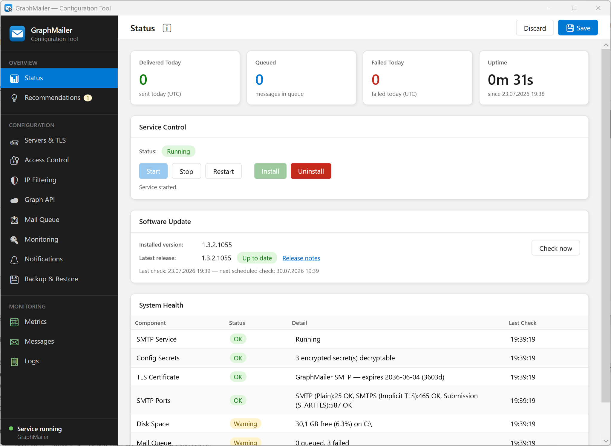
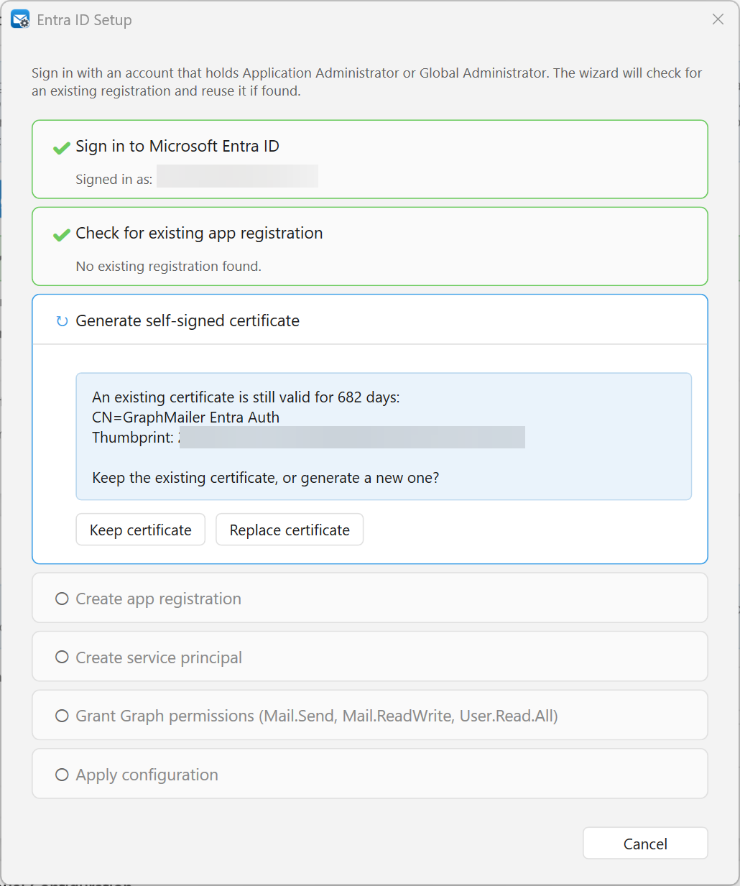
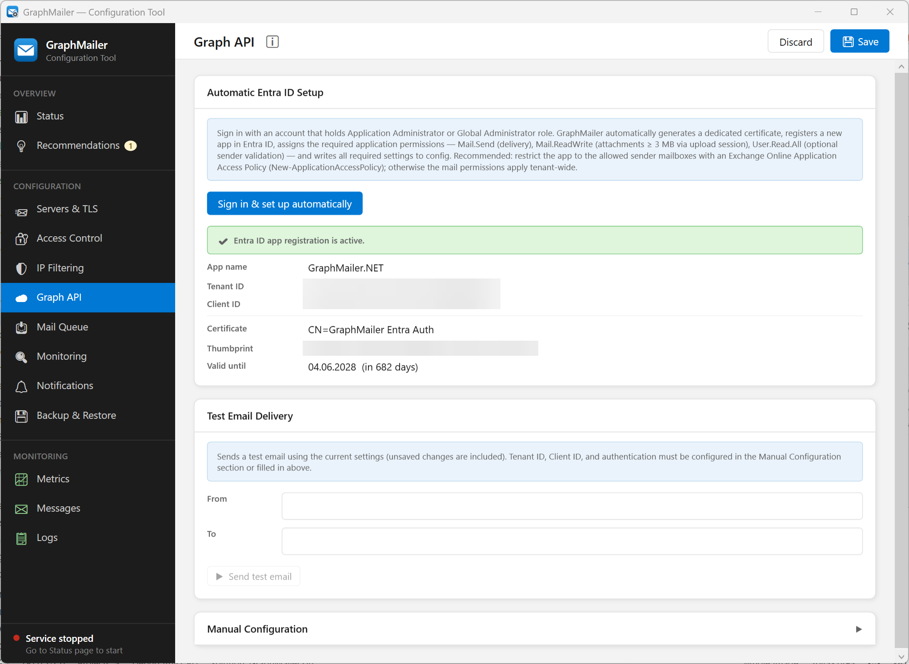
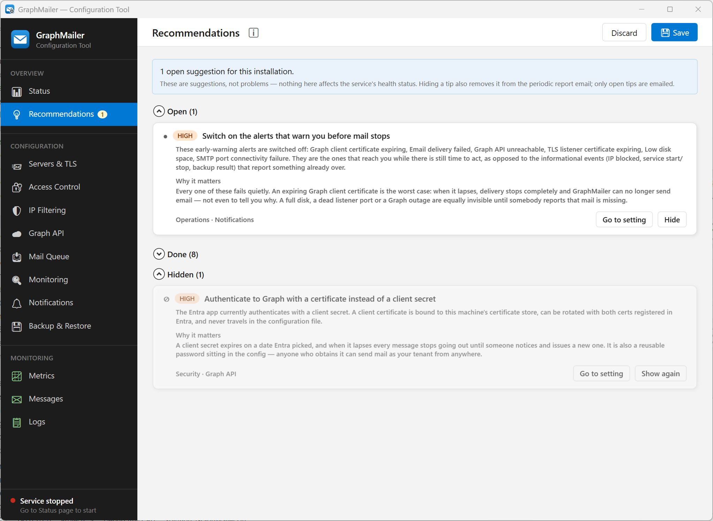
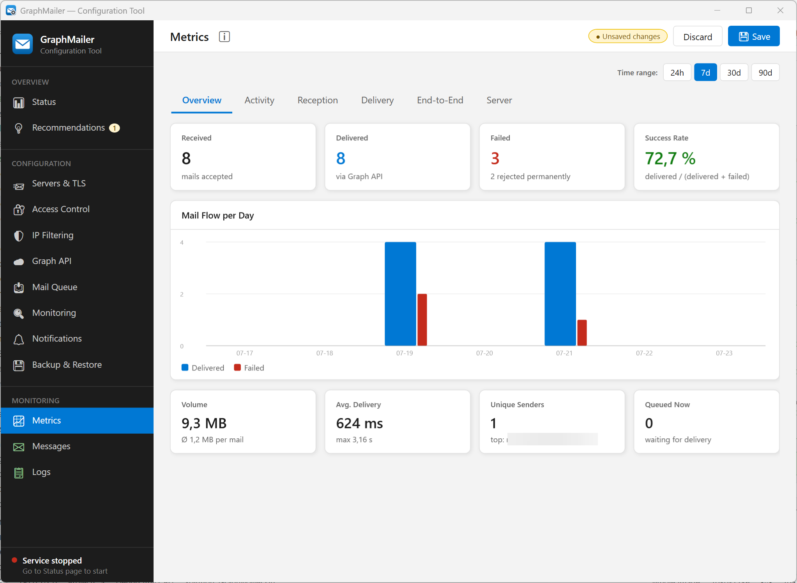

  

<h1 align="center">GraphMailer</h1>

  <b>Keep your scanners, printers and old applications sending mail through Microsoft 365.</b> 
  A Windows SMTP relay that delivers through the Microsoft Graph API. Free and open source.

  
  
  
  

Microsoft is retiring Basic Auth for SMTP in Exchange Online. Devices and applications that only speak plain SMTP stop sending. GraphMailer takes their mail on ports 25, 465 and 587 on a Windows machine in your network and delivers it through the Microsoft Graph API with app-only sign-in. Nothing changes on the devices except the server name.

> [!NOTE]
> **[GraphMailer 1.5.2](https://github.com/debold/GraphMailer.NET/releases/latest) is out.** It follows Microsoft 365's `Retry-After`, so a briefly unavailable mailbox no longer holds mail for minutes. See the [changelog](CHANGELOG.md).

## What makes it different

<table>
  <tr>
    <td width="45%">
      <h3>Set up in minutes, not in the Entra portal</h3>
      A wizard registers the app in your tenant, grants the Graph permissions and creates a certificate for sign-in. No secrets to copy, no PowerShell.
    </td>
    <td></td>
  </tr>
  <tr>
    <td width="45%"></td>
    <td>
      <h3>No mail lost when Microsoft has a bad day</h3>
      Every message lands in a disk queue first. GraphMailer retries on the Exchange schedule, follows <code>Retry-After</code> and holds only the affected mailbox. Senders get a proper bounce only when Microsoft rejects a message for good.
    </td>
  </tr>
  <tr>
    <td width="45%">
      <h3>A relay you can leave open to the network</h3>
      TLS from the Windows certificate store, SMTP users with allowed senders, IP filtering, brute-force blocking, a malware scan through your antivirus (AMSI, e.g. Microsoft Defender) and rules that change recipients or subjects, or reject messages.
    </td>
    <td></td>
  </tr>
  <tr>
    <td width="45%"></td>
    <td>
      <h3>You know before your users call</h3>
      Delivery metrics, a searchable message list and logs in the ConfigTool. Reports by email every day, week or month, and alerts for failed delivery, expiring certificates, a full disk or an unreachable Graph.
    </td>
  </tr>
</table>

## How it works

| Your devices | GraphMailer | Microsoft 365 | You |
|---|---|---|---|
| Scanners, printers, ERP and monitoring send plain SMTP, as today. | A Windows service queues each message on disk and checks it. | Graph sends it as the sender's mailbox, like any other Microsoft 365 mail. | Set up and watch everything in the ConfigTool. No config files to edit. |

## Quick start

1. Download `GraphMailerSetup-<version>.exe` from the [latest release](https://github.com/debold/GraphMailer.NET/releases/latest) and run it. It brings the .NET 10 runtime along.
2. Open the **GraphMailer ConfigTool** and run the **Entra ID setup** on the Graph API page.
3. Add the SMTP users or IP ranges that may send, and the addresses they may send as.
4. Point your devices at the relay. Silent install: `GraphMailerSetup-<version>.exe /quiet /norestart`.

[Help](docs/help/index.md) · [Changelog](CHANGELOG.md) · [Releases](https://github.com/debold/GraphMailer.NET/releases) · [Test documentation](docs/TEST_DOCUMENTATION.md) · [Security](SECURITY.md)

## License

[MIT](LICENSE) © Marc Debold.
